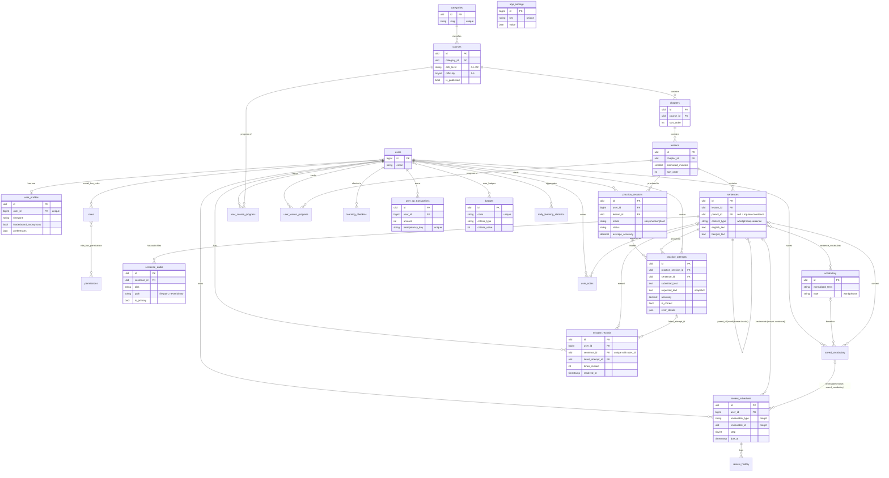

# Lexnora — Database ERD (Phase 2)

Diagram source is Mermaid; GitHub renders it automatically.

- `users` keeps the starter kit's auto-increment id. Every **new** table uses a **ULID** primary key.
- All timestamps are stored in **UTC**. `user_profiles.timezone` is for display only.
- `roles`, `permissions`, `model_has_roles`, `model_has_permissions`, `role_has_permissions` come from `spatie/laravel-permission`.

`app_settings` has no relations: it holds admin-editable rules (scoring, hints per mode, review intervals, XP values, leaderboard metric).

## Relationships explained

| Relationship                                                    | Meaning                                                                                                                                                                                                 |
| --------------------------------------------------------------- | ------------------------------------------------------------------------------------------------------------------------------------------------------------------------------------------------------- |
| `categories → courses`                                          | A category classifies many courses. A course has one category (optional).                                                                                                                               |
| `courses → chapters → lessons → sentences`                      | The learning tree. Deleting a parent permanently removes its children (FK cascade). Day to day, content is **soft deleted**.                                                                            |
| `sentences.parent_id`                                           | A word or phrase row points at the sentence it was cut from. This lets EASY mode play _words → phrases → full sentence_, each with its own audio. Rows with `parent_id = null` are the real sentences.  |
| `sentence_audio`                                                | One sentence can have several audio files; `is_primary` marks the one the player uses.                                                                                                                  |
| `sentence_vocabulary`                                           | Many-to-many: a sentence teaches many words, a word appears in many sentences.                                                                                                                          |
| `practice_sessions → practice_attempts`                         | A session is one run of a lesson in one mode. Each submitted answer is an attempt. The expected text is **copied** into the attempt so later content edits never change history.                        |
| `mistake_records`                                               | One row per user + sentence. It stores the counters and points at the **latest** failing attempt, so the wrong answer and diff are not duplicated.                                                      |
| `review_schedules` / `review_history`                           | Polymorphic: a review item is a `sentence` or a `saved_vocabulary`. `step` indexes the configurable interval list; `interval_days`, `repetitions`, `ease_factor` are ready for spaced repetition later. |
| `user_xp_transactions`                                          | Append-only ledger. A user's XP = `SUM(amount)`. The unique `idempotency_key` makes double rewards impossible.                                                                                          |
| `user_badges` / `user_course_progress` / `user_lesson_progress` | Per-user state. Progress percentages are **derived**, not stored twice.                                                                                                                                 |
| `daily_learning_statistics`                                     | Pre-aggregated numbers for the dashboard charts (one row per user per day). Can be rebuilt from raw tables.                                                                                             |
